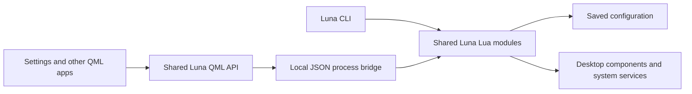

# Luna Settings roadmap

This is the proposed scope and organization for Luna Settings. The current app
provides a themed navigation scaffold with the 12 pages below grouped into
Desktop, Devices, and System. Each page shows a title, description, and “Coming
soon” placeholder. The controls and backend behavior described here still need
to be implemented.

## Pages and navigation

Use a sidebar on the left and settings on the right. Visually group the sidebar
into Desktop, Devices, and System.

| Group | Page | Settings |
| --- | --- | --- |
| Desktop | Appearance | Theme, light/dark preference, fonts, font sizes, icons, cursor |
| Desktop | Wallpaper | Wallpaper selection, local files, image fit, per-monitor backgrounds |
| Desktop | Desktop | Bar layout, visible modules, launcher preferences, desktop behavior |
| Desktop | Windows | Gaps, borders, rounding, blur, opacity, tiling and workspace behavior |
| Desktop | Notifications | Do Not Disturb, duration, position, per-app preferences |
| Devices | Displays | Monitor arrangement, resolution, scaling, refresh rate |
| Devices | Sound | Output/input devices, volume, microphone, notification sounds |
| Devices | Connectivity | Wi-Fi, wired connections, Bluetooth devices |
| Devices | Keyboard & Mouse | Keyboard layout, shortcuts, repeat speed, mouse/touchpad behavior |
| System | Power & Lock | Power profile, idle timeout, screensaver, automatic locking, suspend |
| System | Applications | Default browser/terminal/file manager, startup applications |
| System | System | Luna version, updates, system information, troubleshooting logs |

Each page should contain small groups of related controls, clear descriptions,
and the current saved values. Search should find individual settings and open
the relevant page and control; searching for “rounding” should lead directly to
window rounding.

## Shared behavior

- Save preferences so changes survive closing the app and restarting.
- Read and update the same configuration used by Luna's commands and desktop
  components, keeping the app and CLI synchronized.
- Apply simple preferences immediately. Use an Apply button for disruptive
  changes, and automatically revert display changes unless the user confirms
  them.
- Disable unsupported options and explain why they are unavailable.
- Allow resetting one setting or one group to its defaults.
- Report failures beside the relevant control and indicate when a restart is
  needed.

## Configuration

Keep Luna's personal preferences under `~/.config/luna` (or
`$XDG_CONFIG_HOME/luna` when configured), separate from the installed repository
so updates preserve them. The CLI and UI should use shared Luna modules for
configuration changes. Settings managed by system services should use those
services' existing interfaces.

## Shared backend architecture

Build one shared Lua backend for the CLI, Settings, and other Luna components.
This is the intended architecture; the Settings bridge still needs to be built.

| Layer | Responsibility |
| --- | --- |
| Shared Lua modules | Read settings and available choices, validate changes, save preferences, apply changes, and refresh affected components |
| CLI | Parse arguments, call the shared modules, format terminal output, and report exit status |
| Shared QML API | Expose convenient asynchronous methods and observable loading, result, and error state for QML apps |
| Local bridge | Accept structured requests, call the shared Lua modules directly, and return structured JSON results or errors |
| Settings pages | Display current values, collect user choices, and show progress or failures |

QML and Lua use different runtimes, so the shared QML API needs a bridge to the
Lua backend. Start with a local process exchanging JSON. Keep protocol output
separate from diagnostic logs, and pass operations and values as structured
arguments or input. Each request should report completion or failure so the UI
can remain responsive and show the actual saved state.

Build on the existing `lib/theme` modules. Move reusable theme and font operations
out of CLI-specific handlers into the shared backend, then have both the CLI and
the bridge call those operations. Keep validation, persistence, and application
behavior in those modules so every interface follows the same rules.

The existing `src/qml/Luna` module already provides shared theme values, icons,
and emoji. Extend it with the QML-facing API for backend operations. Other Luna
QML components can reuse that API as their settings become configurable.

## Initial implementation order

Complete one page at a time, including loading saved values, applying changes,
persisting preferences, and reporting failures.

1. Appearance: share the existing theme and font operations through the Lua
   backend, add the local bridge and QML API, and connect the page to them.
2. Wallpaper: connect wallpaper selection and display behavior.
3. Windows: connect the supported Hyprland preferences.
4. Keyboard & Mouse: begin with keyboard and shortcut preferences, then input
   device settings.

Expand to the remaining pages after these core pages work end to end.
